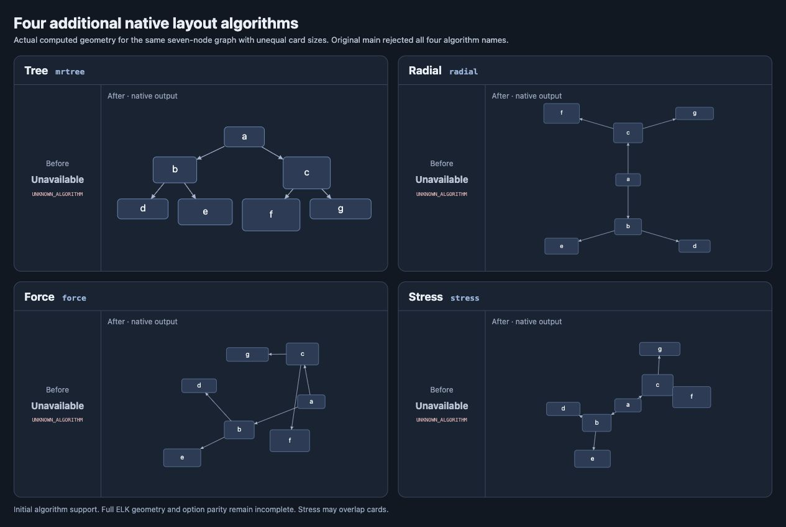

# Additional algorithm coverage

The library implements all eleven algorithm IDs shipped by bundled elkjs 0.11.1.
Algorithm availability does not establish exact ELK geometry compatibility.
The four providers below are native models with measured compatibility gaps.
They share the existing `LayoutAlgorithm` registry and execution path.
The production runtime does not import elkjs.

<!-- provider behavior and options from src/tree.ts, src/force.ts and src/elkjs/provider-options.ts -->

## Native settings

| Algorithm | Typed settings and defaults                                                                                                                                                  | Model                                                                                                                                       |
| --------- | ---------------------------------------------------------------------------------------------------------------------------------------------------------------------------- | ------------------------------------------------------------------------------------------------------------------------------------------- |
| `mrtree`  | `direction: "down"`, `spacing: 20`, `layerSpacing: spacing`, `padding: 20`, optional `rootId`                                                                                | Ordered spanning tree, measured subtree spans and level heights. Cycles become non-tree edges.                                              |
| `radial`  | `radius: 100`, `spacing: 20`, `padding: 12`, `rotation: 0` radians, optional `rootId`                                                                                        | Eades wedges weighted by leaf count. Radius expands to separate measured rectangles. Every component must be a tree.                        |
| `force`   | `model: "FRUCHTERMAN_REINGOLD"`, `spacing: 50`, `seed: 1`, `iterations: 300`, `temperature: 0.001`, `repulsion: 5`, `padding: 50`, optional `priority(node)`                 | Logarithmic springs and inverse-square repulsion. `FRUCHTERMAN_REINGOLD` uses quadratic attraction, inverse-distance repulsion and cooling. |
| `stress`  | `desiredEdgeLength: 100`, `seed: 1`, `iterationLimit: 200`, `epsilon: 0.001`, `dimension: "XY"`, `spacing: 50`, `padding: 50`, optional `edgeLength(edge)` and `fixed(node)` | All-pairs weighted shortest paths and localized stress majorization.                                                                        |

`measure` accepts the existing graph measurement contract. Sizes and numerical
settings must be finite and nonnegative. Iteration limits are integers from zero
to 100000. All providers retain node/edge/graph data and generate fresh routes.
Force and stress use explicit seeded initialization. Disconnected components
pack horizontally. Force weights repulsion by the forcing node's priority and
places components with larger summed node priorities first. Stress keeps authored fixed anchors and locked dimensions
in their original coordinate frame instead of packing that graph. Fixed or
locked components can therefore overlap; the solver does not impose collision
constraints. Stress minimizes center distances and does not guarantee rectangle
separation. Stress computes weighted shortest paths with one sparse Dijkstra
search per node, then retains a quadratic distance table for the stress objective.
It checks cancellation before each search and each majorization iteration,
including when `iterationLimit` is zero. Execution remains synchronous.

## ELK adapter mappings

| Provider | Implemented settings                                                                                                                                          |
| -------- | ------------------------------------------------------------------------------------------------------------------------------------------------------------- |
| All four | `algorithm`, `padding`, `spacing.nodeNode`                                                                                                                    |
| Mr. Tree | `direction`                                                                                                                                                   |
| Radial   | `radial.radius`                                                                                                                                               |
| Force    | `randomSeed`, `force.model`, `force.iterations`, `force.temperature`, `force.repulsion`, node `priority`                                                      |
| Stress   | `randomSeed`, `stress.desiredEdgeLength`, `stress.iterationLimit`, `stress.epsilon`, `stress.dimension`, node `stress.fixed`, edge `stress.desiredEdgeLength` |

Option IDs accept bare, `elk.`, and `org.eclipse.elk.` forms. Graph `layoutOptions`
override graph `properties`, then call options, then constructor defaults,
independently of spelling. Node and edge `layoutOptions` override their `properties`.
Within one source, bare IDs take precedence over `elk.`, then `org.eclipse.elk.`. Selection accepts the same
three algorithm ID forms. The bundled constructor's `algorithms` argument does
not filter inventory, matching the actual bundled oracle.

Unmapped settings under the selected provider's prefix raise an unsupported
option error, including tree weighting/compaction, radial sorting/rotation/
compaction, and force edge `repulsivePower`. That last option inserts repelling
bend particles in ELK; it is not a parent-level repulsion exponent. Common ELK
micro-layout, advanced labels, packing aspect ratio, and interactive options
are not fully reproduced. Explicit ports, nested child scopes, and hyperedges
are rejected for these providers. Native scoped execution and geometry
constraints are also rejected.

## Verification and remaining work

<!-- exact comparisons from scripts/check-additional-provider-parity.ts; functional checks from test/additional-providers.test.ts -->

The 61 behavior tests cover empty/singleton, measured branching, disconnected
components, permitted cycles, radial cycle rejection, data preservation,
immutability, finite routes, wide radial fanout, seed repeatability, option effects,
fixed anchors, locked dimensions, ID aliases, precedence across option sources,
root-port rejection, weighted shortest paths, cancellation during distance
construction, and explicit errors.
The packed consumer smoke test runs all four through native `getLayout` and the
worker API against the built package.

The independent oracle uses the real development dependency `elkjs` 0.11.1.
Run the strict comparison with an optional JSON output path:

```sh
pnpm exec tsx scripts/check-additional-provider-parity.ts /tmp/provider-parity.json
```

| Comparison                                   | Cases | Current result                          |
| -------------------------------------------- | ----: | --------------------------------------- |
| Bundled algorithm descriptions               |    11 | Exact ID/name/category/options metadata |
| Bundled categories                           |     8 | Exact metadata                          |
| Empty/singleton full node/bounds output      |     8 | Exact geometry                          |
| Branch/cycle/disconnected nontrivial layouts |    11 | Geometry differs from ELK               |
| Radial cycle                                 |     1 | Exact pinned exception text             |

The strict command exits nonzero on those eleven geometry mismatches. Rejection cases
are recorded rather than silently skipped. Discovery metadata describes the
pinned ELK inventory; it does not promise every discovered option is implemented.

The [retained oracle report](algorithm-coverage/oracle-report.json) includes
both engines' geometry for every case. The screenshot below renders the actual
native branching outputs from that report beside the [original unsupported state](algorithm-coverage/before.json).



Exact compatibility still needs ELK tree ordering, apportionment, compaction,
non-tree edge routing, radial root selection/wedge/rotation optimizers, force
initialization and bend particles, stress initialization and importer behavior,
and the shared ELK component packing/micro-layout pipeline. These additions do
not close that work and do not establish aesthetic equivalence to Pele.
