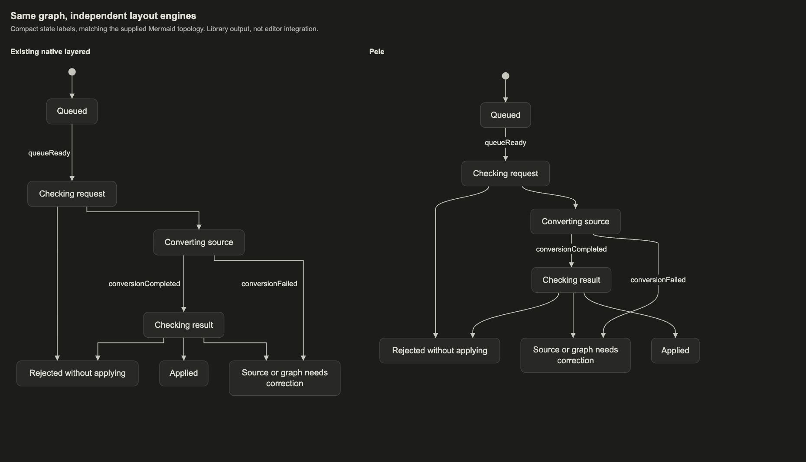
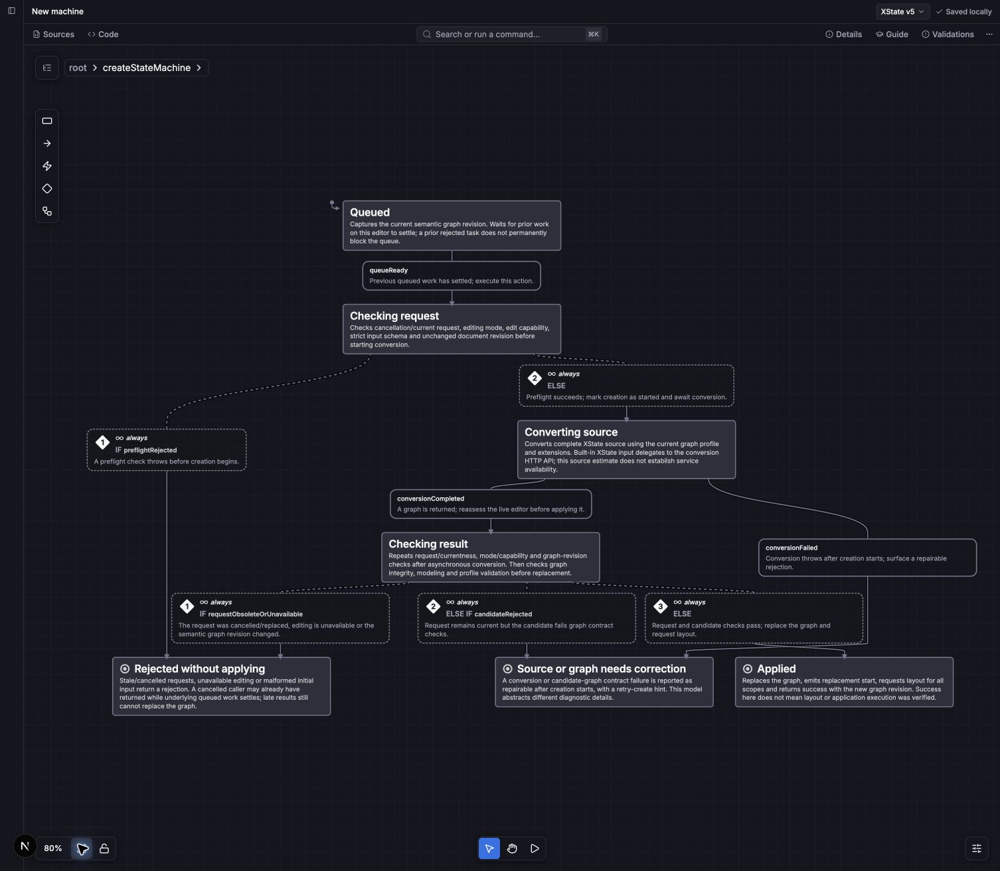
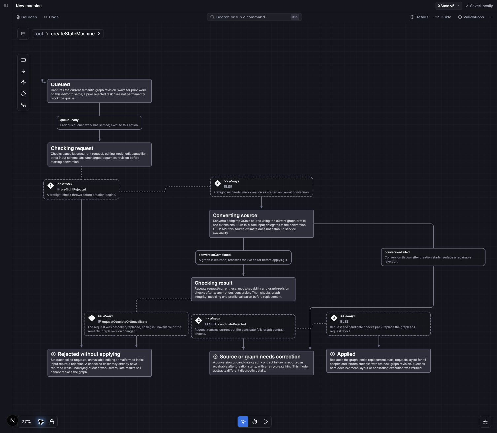

# Pele layout comparison

<!-- fixture and preview generation from scripts/preview-pele.ts and test/fixtures/pele-request.ts -->

Both panels use the same graph and explicit dimensions. The left panel runs the
existing native layered engine; the right panel runs the separate Pele engine.
This is library output, not an editor screenshot or an editor integration.



The [description and guard example](descriptions-and-guards.svg) retains the
state descriptions and guarded transition cards. These are fixture dimensions,
not measurements captured from the editor. Tests check data preservation,
non-overlapping boxes in four directions, and curve clearance in the request
fixture. They do not establish collision-free routing for every graph.

Regenerate both HTML comparisons, Pele SVGs, and geometry JSON with:

```sh
pnpm exec tsx scripts/preview-pele.ts
```

Outputs appear in `.scratch/pele-preview/`. The PNG is a browser capture of the
compact HTML comparison. The SVG is direct rendering of the current route
sections and label boxes. See `NOTICE.md` for upstream attribution and the local
change that keeps bypass bends outside full label bands for large guard cards.

## Local editor trial

The original described state machine was imported through the actual editor's
Code panel. The project-scoped layout strategy was set to Pele and the
"Layout down" command applied. The local Viz adapter consumes Pele's route
sections as well as node and transition-card positions. Geometry changes fall
back to normal editor routing until the next layout.

The [captured DOM evidence](editor-evidence.json) contains seven states, eight
transition labels, fifteen descriptions, and zero overlapping node/label boxes.
The original three guards remain visible. Separate editor integration tests
passed for the original source, strategy dispatch, route preservation, and
fallback after movement or label resizing, along with existing layout tests
(133 tests total).

This uses an unshipped local editor prototype linked to this PR's package.
Editor source changes are not part of this library PR. It does not establish
production behavior, nested-state support, or collision-free routing for every
graph. The two captures use the same source and each engine's fit-to-content
view, so their zoom levels differ.

Pele in the actual editor:



The existing ELK-compatible editor layout for comparison:


