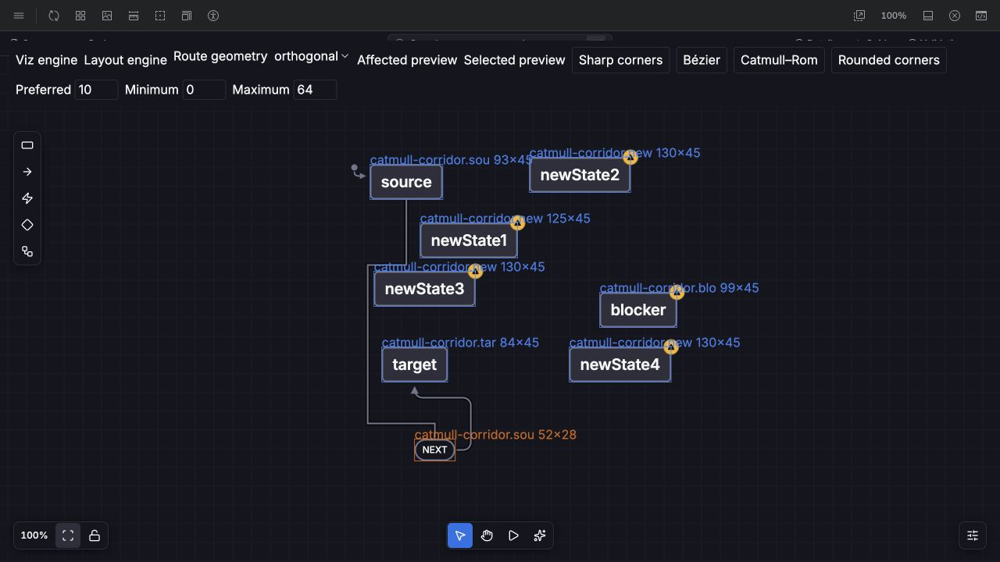
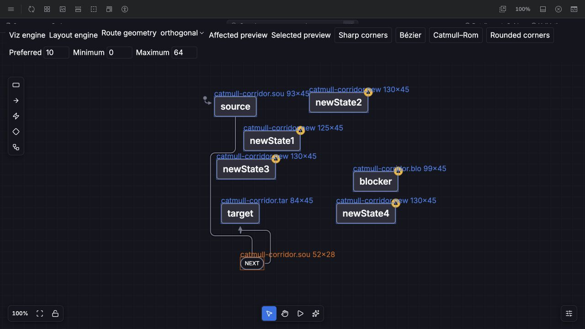

# Consistent orthogonal corners

Same captured corridor scene, orthogonal geometry, rounded curve, preferred radius 10,
minimum 0, maximum 64, 100% canvas zoom. Before: observed mixed sharp/rounded
label legs in the old browser bundle. After: pinned Layout 38c1cf3, both legs rounded.
Nodes and label remain fixed; routing may select a different safe corridor.

| Before | After |
| --- | --- |
|  |  |

Viz's `Canvas/NativeRouting/RoundedCorners` story exposes Preferred, Minimum and
Maximum controls. Browser proof also exercised maximum 2 and a 32-unit label drag,
then restored the label and default radius. Automated coverage checks initial,
preview and commit phases for caps 0/2/10, allowed-side label midpoints, terminal
arrow direction, and the existing 4,000-search-node edge budget.

[Benchmark runs](rounded-corner-preview-runs.json) retain work, patch, serialization,
fallback and error counts. Five alternating trials after warmup passed with zero
errors and zero fallbacks on sparse 100/1,000-edge and 24-edge obstacle corridors.
Shared-host contention makes timing comparisons inconclusive; no browser FPS claim.
