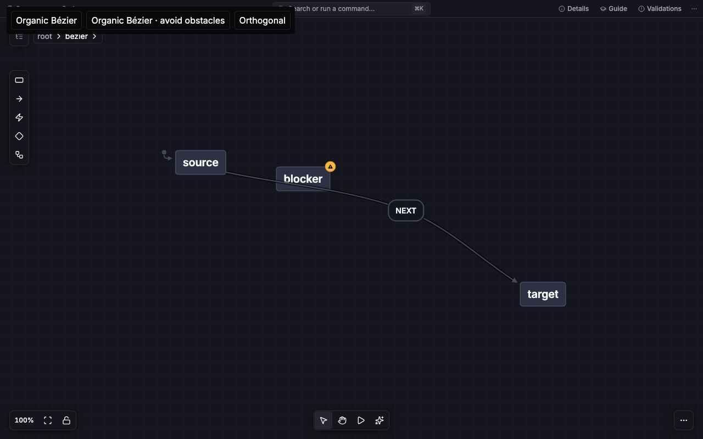
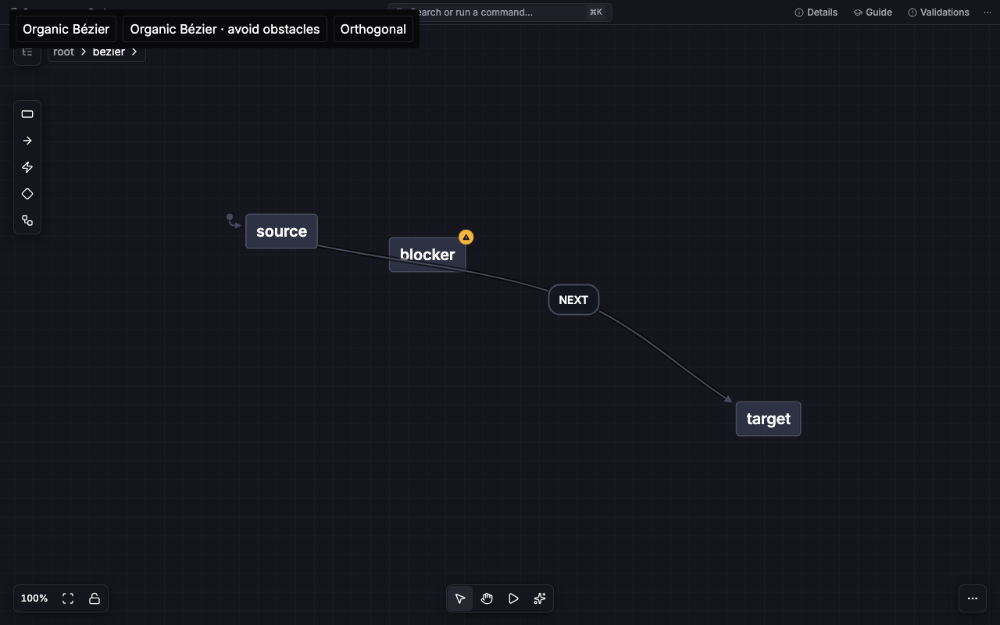
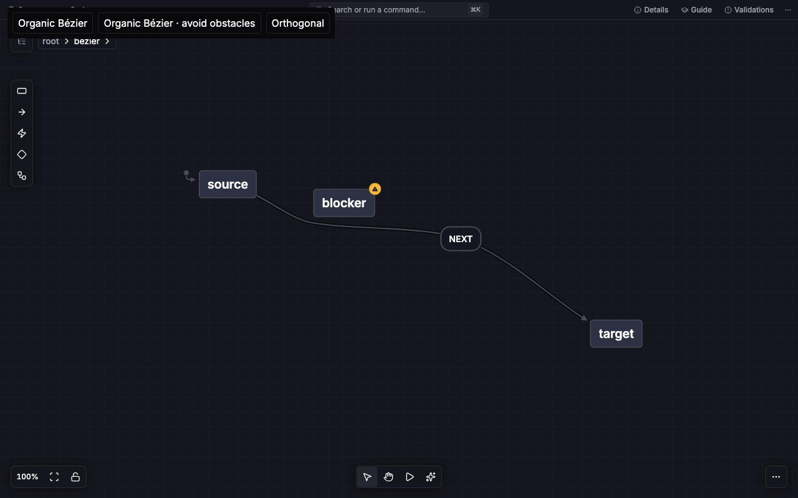
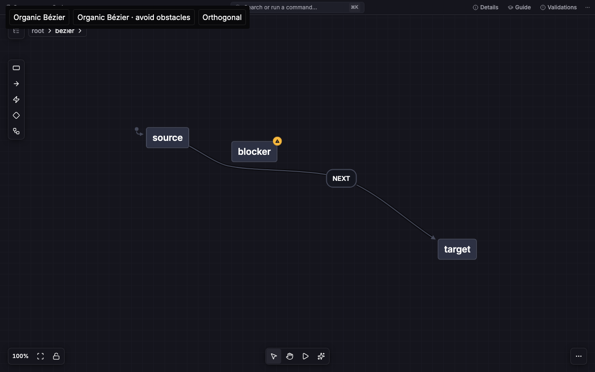
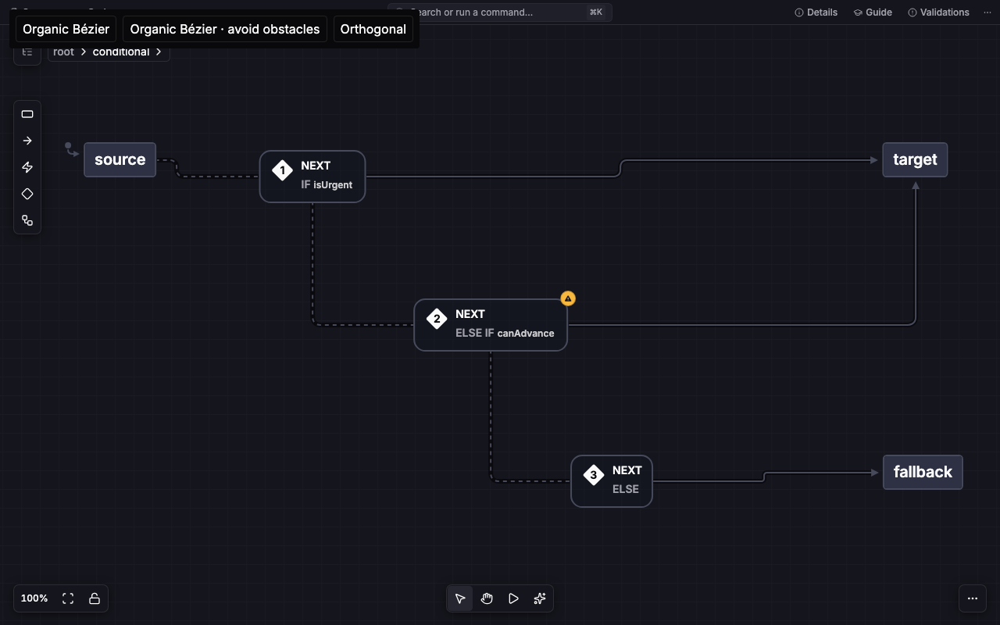

# Shared Bézier routing migration

This records the initial migration at `817bd9c`. The subsequent
[routing policy work](../policies/README.md) extends the same strategies and
records its verification separately.

The existing `bezierRouting.route/update` API owns floating curves and complete
label-source chains. Viz supplies semantic topology and connection/obstacle
frames. It renders returned sections and attachment sides. The library does not
know about statecharts, event grouping, invokes, or Flow.

The opt-in API keeps legacy Bézier defaults compatible. Its public constraints
cover fixed ports, floating or orthogonal attachments, allowed sides, shared
label-center tangents, arrow clearance, explicit obstacles, and optional guides
for self-loops or hierarchy. A `sourceLabel` edge ID follows current label
geometry. Invalid parent constraints reject descendants together.

See [the public options](../../routing.md#center-tangent-bézier-routing-and-label-chains)
and [the decision trail](decisions.tsv).

## Review and verification

Independent reviews reproduced dropped waypoints, floating named target ports,
unsafe obstacle fallback, ignored supplied-guide sides, and inward-frame
rejections. Regressions now cover each case. The final review reran 70 library
tests, 68 consumer tests, and 45 fresh-versus-incremental comparisons with no
remaining confirmed bug. Review also checked top-side parent-label departures,
sibling reservation exhaustion, narrow connection frames, self-loops,
targetless edges, and final arrow approach direction.

The final full library run passed 1,969 tests. Library/repository typechecks,
build, lint, and package smoke checks passed. Lint retains two existing warnings.
Viz passed 286 affected geometry, adapter, settings, and rendering tests plus
its editor typecheck. Consumer package installation and packaging are recorded
separately in the consumer PR, because they depend on the pinned library commit.

## Matching image proof

The before column runs Viz PR 889's implementation. The after column runs the
shared algorithm on the same two Storybook fixtures. Both use a 1280 by 800
viewport, device scale 1, settled initial layout, and loaded fonts. No placement
or fixture values changed. The original PR remains untouched.

| Fixture and mode       | Before                                                           | After                                                          |
| ---------------------- | ---------------------------------------------------------------- | -------------------------------------------------------------- |
| Ordinary, simple       |           |           |
| Ordinary, avoiding     |       |       |
| Three labels, simple   |      |      |
| Three labels, avoiding |  |  |

The live check also drags the parent label and asserts that its child source
moves with it and touches the moved parent label's border. It checks finite,
nonempty paths in both modes and no browser runtime errors. Screenshots are
review artifacts, not new visual-test baselines.

## Dependency order

Viz PR 889 is merged. Layout 0.5.0 released the shared routing API. During
review, Viz used an immutable Git revision so installation and CI did not depend
on unpublished npm code. The consumer tracked replacement of that temporary pin
separately.
