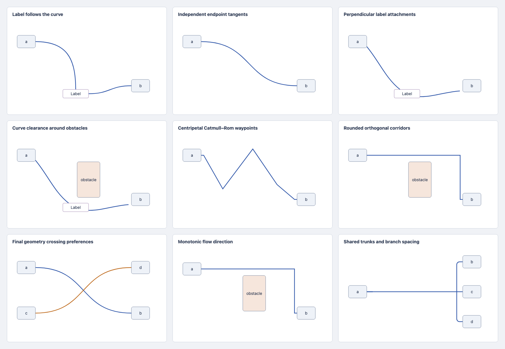
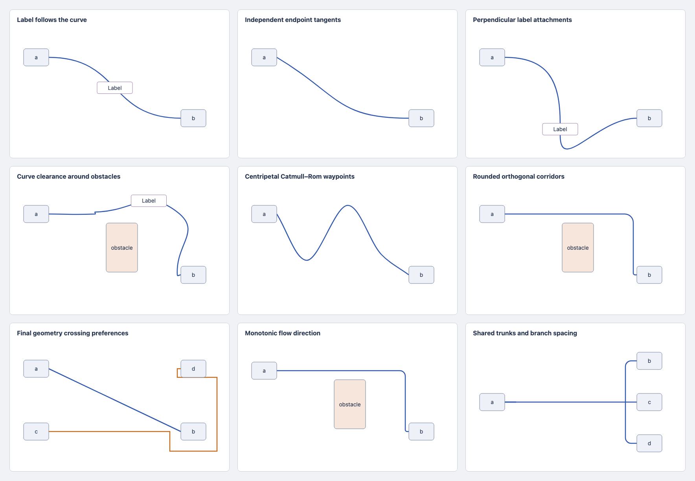

# Routing policy evidence

The nine examples use identical graph input, authored direction, dimensions,
scale, and viewport before and after policy selection. The before source is
commit `817bd9c`. The after source adds the policy API. Metadata records the
source revision used by each renderer run.

| Original settings                       | Routing policies                     |
| --------------------------------------- | ------------------------------------ |
|  |  |

The examples cover following labels, endpoint tangents, label-border tangents,
obstacle clearance, Catmull–Rom waypoints, rounded orthogonal paths, crossing
preferences, monotonicity, and shared trunks. A conflict can remain because
crossings are finite costs. Orange paths carry fallback diagnostics.

## Reproduce

The committed before data preserves the original implementation's geometry.
Generate the current policy examples with the public routing API.

```sh
mkdir -p .scratch/routing-policies
cp -R docs/routing/policies/before .scratch/routing-policies/
pnpm routing:gallery .scratch/routing-policies/after --after
pnpm verify:routing-policies
```

`routes.json` stores graph inputs, settings, and structured routes. `index.html`
and the per-case SVG files are standalone review artifacts. The same fixtures
power **Routing / Policies / Playground** in Storybook.

`node scripts/verify-routing-policies.mjs` captures both galleries, verifies
identical inputs and finite visible browser paths, and writes a browser report.
The optional screenshot driver uses an installed `@playwright/test` module.
Set `ROUTING_BROWSER_MODULE` to its absolute package directory if it is outside
this repository. Set `ROUTING_STORYBOOK_URL` to include the live Storybook checks.
Those checks exercise every example and verify that a following label moves
after a source-node edit. No browser dependency enters the published library.

## Verified source

Source `e6181ca` passes the full `pnpm verify`: 2,048 tests across 141 files,
source/repository/demo/Storybook type checks, demo and Storybook builds,
publint, and packed ESM/CommonJS/TypeScript smoke checks. Two existing lint
warnings remain.

The deterministic corpus passes 672 cases: twelve routing strategies, seven
policies, and eight seeded graphs. It reports 64 explicit curve fallbacks and
zero empty routes. Random graphs exercise rectangular nodes and edges; focused
unit tests cover labels, ports, authored waypoints, and custom barriers.

The [browser report](browser-report.json) records nine matching static examples,
nine live Storybook examples, and a following label moving after a node edit.
Independent final review re-ran all four reported regressions and eight focused
tests, with no confirmed remaining finding.

The same packed source also passes 286 affected tests in a fresh main-based
Viz migration checkout, its editor typecheck, and its package build/artifact
verification. Installed routing source hashes match `e6181ca`. That checkout
uses a local tarball for verification; no consumer dependency update is published.

## Evidence boundaries

The seeded public-API corpus checks finite geometry, hard node avoidance,
canonical fresh/update equivalence, no-op updates, input-order invariance,
shared-trunk consistency, and explicit fallback diagnostics. The unit suite
checks individual curve, tangent, label, monotonicity, and preservation contracts.
Packed package smoke checks exercise ESM, CommonJS, and published TypeScript.

Screenshots support visual review. They do not establish a global crossing
optimum, shape-general obstacle avoidance, or yEd quality parity.

See [the policy reference](../../routing-policies.md),
[the design decision](design.md), and [the decision trail](decisions.tsv).
