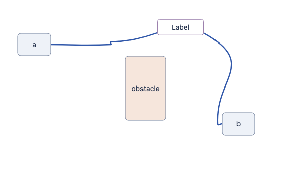
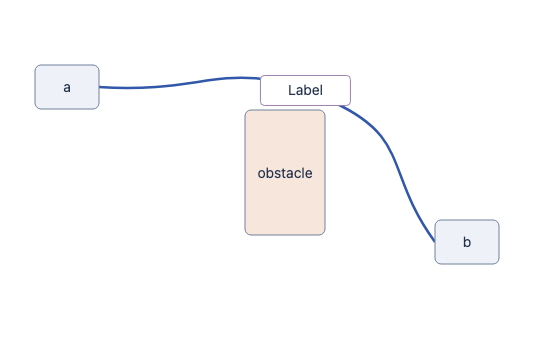

# Curve clearance quality

<!-- curve guide selection and regressions from src/routing/algorithms.ts and test/routing-policy-clearance-quality.test.ts; matched comparison from comparison.json -->

The reported route was hard-safe but visibly awkward. Its orthogonal search
vertices included a five-pixel step beside long spans. Interpolating those
vertices produced an unnecessary bulge and a hook near the target. The previous
checks established clearance and consistency, but missed this quality defect.

The refinement offers a compact visibility guide to the existing Bézier fitter.
Authored anchors, requested curvature, tangents, final clearance, crossing costs,
and safe fallback behavior retain their existing contracts. No fixture position
or policy value changes between these images.

| Reported at `1a712a4`             | Refined at `3724487`            |
| --------------------------------- | ------------------------------- |
|  |  |

The paired PNG captures and SVG fixture viewBoxes are 560 by 340. Both use
device scale 1 and identical graph input, dimensions, policy, and loaded fonts.
`browser.json` records a separate live Storybook check with a 1050 by 780 browser
viewport. That viewport differs from the paired fixture captures. The policy
uses curvature `0.5` and a following label. The SVGs and JSON metrics are stored
alongside the images.

| Geometry                        |  Reported |   Refined |
| ------------------------------- | --------: | --------: |
| Browser path length             | 528.62 px | 417.32 px |
| Horizontal reverse travel       |  28.92 px |      0 px |
| Cubic segments                  |         5 |         2 |
| Final curve obstacles hit       |         0 |         0 |
| Following label overlaps a node |        No |        No |

Run the behavioral regression, including reflection and 90/180-degree rotation:

```sh
pnpm exec vitest run test/routing-policy-clearance-quality.test.ts
```

Before the fix, four variants failed with `expected 528.6161642734512 to be less
than 460`. All variants must also preserve hard clearance, following-label
non-overlap, and bounds on reverse travel. Separate cases preserve authored
waypoints/tangents, canonical obstacle updates, and the shared search budget.
These checks measure the reported defect, not universal routing optimality.
